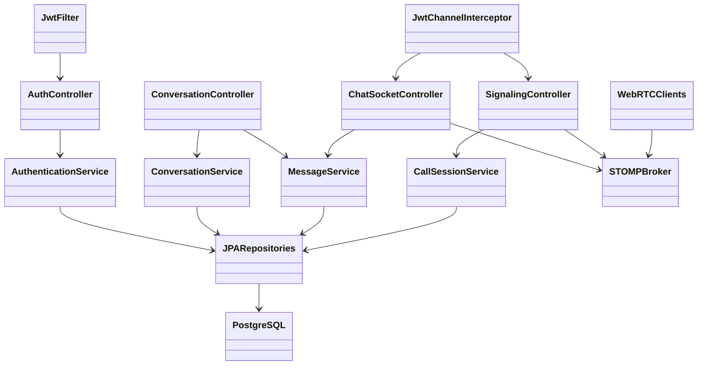
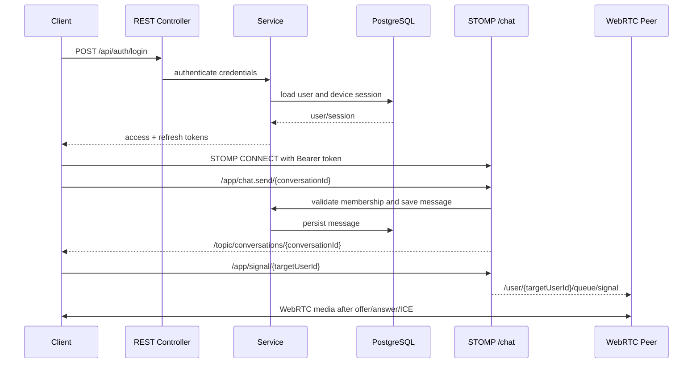

# 🚀 chatInLove - Real-time Chat Backend

A production-ready **Spring Boot 3** backend for a full-featured chat application with real-time messaging, device sessions, WebSocket support, and WebRTC call signaling.

## ✨ Features

✅ **Authentication & Security**
- JWT-based stateless authentication (15-minute access tokens, 7-day refresh tokens)
- Device session tracking and management
- Email normalization and unique constraints
- BCrypt password hashing
- Automatic token refresh mechanism

✅ **Real-time Messaging**
- STOMP/WebSocket protocol with Spring Messaging
- Private 1-to-1 conversations
- Group chat (extensible)
- Cursor-based pagination for message history
- Real-time typing indicators
- Message editing and soft deletion
- Read status tracking

✅ **Conversation Management**
- Automatic private key generation for privacy
- Conversation member roles (OWNER, ADMIN, MEMBER)
- Active membership tracking (joinedAt, leftAt)
- Last message tracking for sorting

✅ **Device Sessions**
- Track which devices user is logged in on
- Device identification (name, type, OS)
- IP address tracking
- Session revocation capability
- Automatic token cleanup on expiry

✅ **Error Handling**
- Consistent error response format
- 401 for authentication errors (not 403)
- Comprehensive exception handling with `@RestControllerAdvice`
- Validation error messages
- Transaction management for data integrity

✅ **API Standards**
- RESTful endpoints for all operations
- STOMP/WebSocket for real-time features
- Pagination support (REST and WebSocket)
- Proper HTTP status codes
- CORS enabled for all origins
- Request/response validation with Jakarta validation

---

## 📁 Project Structure

```
chat-love-in/
├── src/main/java/org/dr/
│   ├── config/                      # Configuration
│   │   ├── SecurityConfig.java
│   │   ├── WebSocketConfig.java
│   │   ├── JwtProperties.java
│   │   └── ChatProperties.java
│   │
│   ├── controller/                  # REST Controllers
│   │   ├── AuthController.java
│   │   └── ConversationController.java
│   │
│   ├── ws/                          # WebSocket Controllers
│   │   ├── ChatSocketController.java
│   │   └── JwtChannelInterceptor.java
│   │
│   ├── service/                     # Business Logic
│   │   ├── AuthenticationService.java
│   │   ├── JwtService.java
│   │   ├── DeviceSessionService.java
│   │   ├── ConversationService.java
│   │   └── MessageService.java
│   │
│   ├── repository/                  # Data Access
│   │   ├── UserRepository.java
│   │   ├── DeviceSessionRepository.java
│   │   ├── ConversationRepository.java
│   │   ├── ConversationMemberRepository.java
│   │   ├── MessageRepository.java
│   │   ├── GroupInviteRepository.java
│   │   └── InviteLinkRepository.java
│   │
│   ├── model/                       # JPA Entities
│   │   ├── User.java
│   │   ├── DeviceSession.java
│   │   ├── Conversation.java
│   │   ├── ConversationMember.java
│   │   ├── Message.java
│   │   ├── GroupInvite.java
│   │   ├── InviteLink.java
│   │   └── enums/
│   │       ├── UserRole.java
│   │       ├── ConversationType.java
│   │       ├── ConversationMemberRole.java
│   │       ├── MessageType.java
│   │       ├── DeviceType.java
│   │       ├── CallType.java
│   │       ├── CallStatus.java
│   │       └── InviteStatus.java
│   │
│   ├── dto/                         # Data Transfer Objects
│   │   ├── request/
│   │   │   ├── RegisterRequest.java
│   │   │   ├── LoginRequest.java
│   │   │   ├── RefreshTokenRequest.java
│   │   │   ├── SendMessageRequest.java
│   │   │   ├── CreatePrivateConversationRequest.java
│   │   │   ├── CreateGroupRequest.java
│   │   │   ├── InviteUsersRequest.java
│   │   │   └── CreateInviteLinkRequest.java
│   │   └── response/
│   │       ├── AuthResponse.java
│   │       ├── UserResponse.java
│   │       ├── DeviceSessionResponse.java
│   │       ├── ConversationResponse.java
│   │       ├── ConversationMemberResponse.java
│   │       ├── MessageResponse.java
│   │       ├── GroupInviteResponse.java
│   │       ├── InviteLinkResponse.java
│   │       └── ErrorResponse.java
│   │
│   ├── exception/                   # Exception Handling
│   │   ├── GlobalExceptionHandler.java
│   │   ├── ResourceNotFoundException.java
│   │   ├── InvalidCredentialsException.java
│   │   ├── DuplicateResourceException.java
│   │   └── UnauthorizedException.java
│   │
│   ├── util/                        # Utilities
│   │   ├── JwtFilter.java
│   │   └── TokenGenerator.java
│   │
│   └── ChatLoveInApplication.java   # Main Application
│
├── src/main/resources/
│   └── application.properties       # Configuration
│
├── pom.xml                          # Maven Dependencies
├── API_DOCUMENTATION.md             # Complete API Spec
├── FRONTEND_PROTOCOL.md             # Frontend Integration Guide
├── FRONTEND_QUICK_START.md          # Quick Start for Frontend Dev
└── README.md                        # This file
```

---

## 🚀 Quick Start

### Prerequisites
- Java 17+
- PostgreSQL 12+
- Maven 3.8+

### Setup

1. **Clone and navigate:**
   ```bash
   cd ChatInLove
   ```

2. **Setup database:**
   ```bash
   # Create database
   createdb chatinlove
   
   # Or use Docker:
   docker run -d \
     --name postgres \
     -e POSTGRES_DB=chatinlove \
     -e POSTGRES_PASSWORD=postgres \
     -p 5432:5432 \
     postgres:15
   ```

3. **Configure the database and JWT:**
   
   `src/main/resources/application.properties` reads the following environment
   variables. Set them in your shell or deployment provider instead of
   committing credentials:

   ```bash
   export SPRING_DATASOURCE_URL='jdbc:postgresql://localhost:5432/chatinlove'
   export SPRING_DATASOURCE_USERNAME=postgres
   export SPRING_DATASOURCE_PASSWORD=postgres
   export APP_FIREBASE_CREDENTIALS_JSON='...'
   ```

   Set a production JWT secret in the configuration used by your environment:

   ```properties
   app.jwt.secret=your-secret-key-min-32-chars
   app.jwt.expiration-minutes=15
   app.jwt.refresh-expiration-days=7
   ```

4. **Build and run:**
   ```bash
   bash mvnw clean package
   bash mvnw spring-boot:run
   ```

   The server starts on `http://localhost:2026` by default. Set `PORT` to
   override it.

5. **Test endpoint:**
   ```bash
   curl http://localhost:2026/api/auth/principal \
     -H "Authorization: Bearer {token}"
   ```

---

## 📚 Documentation

### For Frontend Developers
Start here to integrate with this backend:

1. **[FRONTEND_QUICK_START.md](./FRONTEND_QUICK_START.md)** - Get chat working in 5 minutes
2. **[FRONTEND_PROTOCOL.md](./FRONTEND_PROTOCOL.md)** - Detailed protocol specifications
3. **[API_DOCUMENTATION.md](./API_DOCUMENTATION.md)** - Complete API reference

### For Backend Developers
Extend and maintain the backend:

1. **[API_DOCUMENTATION.md](./API_DOCUMENTATION.md)** - Full endpoint documentation
2. **Javadoc** - Inline code documentation
3. **README.md** - This file

---

## 🔐 Authentication

### Flow
```
User Input → Register/Login → Device Session Created → Tokens Returned
                                    ↓
                            JWT Validation on Each Request
                                    ↓
                            Token Refresh Before Expiry
                                    ↓
                            Logout/Revoke Session
```

### Tokens
- **Access Token**: 15 minutes, includes session ID (`sid`)
- **Refresh Token**: 7 days, used to get new access tokens
- **Stored Securely**: Device session tracks refresh token hash

---

## 💬 Real-time Chat

### STOMP Destinations

**Send Message:**
```
Client: /app/chat.send/{conversationId}
Server: /topic/conversations/{conversationId}
```

**Typing Indicator:**
```
Client: /app/chat.typing/{conversationId}
Server: /topic/conversations/{conversationId}/typing
```

**Notifications:**
```
Server: /user/queue/notifications
```

### Message Lifecycle
```
Frontend sends → REST API save to DB → Broadcast via WebSocket → 
Frontend receives → Display in UI → Mark as read
```

---

## 🗄️ Database Schema

### Key Tables
- `users` - User accounts with email unique constraint
- `device_sessions` - Track logged-in devices with refresh token hash
- `conversations` - 1-to-1 (privateKey) and group chats
- `conversation_members` - Conversation membership with roles
- `messages` - Chat messages with soft delete (deletedAt)
- `group_invites` - Pending/accepted/declined invites
- `invite_links` - Secure invite links with expiry

All IDs are UUIDs (String type) for security and scalability.

---

## 🛡️ Security Features

✅ **JWT Authentication**
- HMAC-SHA256 signing
- Session ID in token claims
- Token validation on every request

✅ **Authorization**
- Membership checks (only members can read/send)
- Role-based access (OWNER/ADMIN/MEMBER)
- Device session validation (reject revoked sessions)

✅ **Input Validation**
- Jakarta validation annotations on all DTOs
- Email normalization (trim, lowercase)
- Consistent error responses

✅ **HTTP Security**
- Stateless sessions (no server-side storage)
- CSRF disabled (JWT protection)
- CORS enabled for frontend
- 401 returned for unauthenticated requests (not 403)

---

## 📊 API Statistics

### REST Endpoints: 20+
- 8 Authentication endpoints
- 5 Conversation endpoints
- 7 Message endpoints
- (Future: Group management, calls)

### WebSocket Endpoints: 3
- Message sending (`/app/chat.send`)
- Typing notifications (`/app/chat.typing`)
- Personal notifications (`/user/queue/notifications`)

### Response Formats
- List responses: Page with `content`, `totalPages`, `totalElements`
- Error responses: Consistent JSON with `status`, `error`, `message`

---

## 🔄 Data Flow Examples

### Register → Login → Send Message

```
1. POST /api/auth/register
   → User created
   → Device session created
   → Tokens returned

2. Store accessToken and refreshToken locally

3. GET /api/conversations/private
   → Create conversation with friend
   → Returns conversation object

4. GET /api/conversations/{id}/messages
   → Load message history

5. Connect WebSocket with accessToken
   → Subscribe to /topic/conversations/{id}

6. Send message via /app/chat.send/{id}
   → Message saved to DB
   → Broadcasted to all subscribers
   → Received real-time in UI
```

---

## 🧪 Testing

### Test REST API
```bash
# Register
curl -X POST http://localhost:2026/api/auth/register \
  -H "Content-Type: application/json" \
  -d '{
    "email": "test@example.com",
    "username": "testuser",
    "password": "Test123!"
  }'

# Login
curl -X POST http://localhost:2026/api/auth/login \
  -H "Content-Type: application/json" \
  -d '{
    "email": "test@example.com",
    "password": "Test123!"
  }'

# Get conversations (use returned accessToken)
curl http://localhost:2026/api/conversations \
  -H "Authorization: Bearer {accessToken}"
```

### Test WebSocket
Use browser DevTools or Postman WebSocket client:
```
URL: ws://localhost:2026/chat
Header: Authorization: Bearer {accessToken}
```

---

## 🚀 Performance Considerations

- **Pagination**: All list endpoints support pagination
- **Cursor Pagination**: Messages use `before` parameter to efficiently load history
- **Lazy Loading**: Only load active conversations' messages
- **Indexing**: Database indexes on foreign keys, email, unique constraints
- **Connection Pooling**: HikariCP for database connections

---

## 🐛 Troubleshooting

### WebSocket Connection Failed
```
Problem: Can't connect to /chat
Solution: Check JWT is valid, Authorization header format: "Bearer {token}"
```

### 401 Unauthorized
```
Problem: All requests return 401
Solution: Token expired, call POST /api/auth/refresh or login again
```

### Message Not Real-time
```
Problem: Messages appear after page refresh, not real-time
Solution: Check WebSocket subscription destination and connection status
```

### Database Connection Error
```
Problem: Can't connect to PostgreSQL
Solution: 
- Ensure PostgreSQL is running
- Check connection string in application.properties
- Verify database exists and user has permissions
```

---

## 📋 Roadmap

### ✅ Completed
- [x] Authentication with device sessions
- [x] JWT token management
- [x] 1-to-1 conversations
- [x] Real-time messaging
- [x] WebSocket STOMP support
- [x] Message editing/deletion
- [x] Read status tracking

### ✅ Also implemented
- [x] Group conversations and invitations
- [x] Invite links with expiry
- [x] 1-to-1 and group WebRTC signaling
- [x] Call sessions and push notifications
- [x] File uploads and media streaming

### 📅 Planned
- [ ] STUN/TURN and SFU production infrastructure
- [ ] Message search and reactions
- [ ] User blocking and admin dashboard

---

## 📞 Support

### Check These First
1. Is the backend running? `bash mvnw spring-boot:run`
2. Is PostgreSQL running? `psql -U postgres -d chatinlove`
3. Is the JWT token valid? Check expiry time
4. Are WebSocket headers correct? Check Authorization format
5. Check browser console for errors
6. Check server logs: `tail -f logs/app.log`

### Common Fixes
```bash
# Clean build if facing compilation errors
bash mvnw clean compile

# Rebuild database schema
# (Update SQL in application.properties: ddl-auto=create)

# Check server is listening
lsof -i :8080

# View logs with grep
grep ERROR logs/app.log
```

---

## 📄 License

This project is part of the chatInLove application suite.

---

## 📝 Notes

- **JWT Secret**: Change in production! Use environment variable.
- **Database**: Migrate to PostgreSQL for production
- **CORS**: Set specific origins instead of "*" in production
- **Logging**: Configure proper log levels per environment
- **Monitoring**: Add application metrics and health checks
- **Rate Limiting**: Implement per-user and per-IP rate limits

---

## 🎯 Next Steps

### For Frontend Team
1. Read [FRONTEND_QUICK_START.md](./FRONTEND_QUICK_START.md)
2. Setup React/Angular/Vue project
3. Implement login/register UI
4. Integrate WebSocket
5. Test with backend

### For Backend Team
1. Extend with group chat features (Step 4)
2. Implement call signaling (Step 5)
3. Add unit and integration tests
4. Setup CI/CD pipeline
5. Deploy to staging/production

---

**Built with ❤️ using Spring Boot 3, Java 17, PostgreSQL**

**Last Updated:** November 18, 2026
**Version:** 1.0.0-SNAPSHOT

## Architecture

The backend separates HTTP resource operations from real-time messaging. JWT
authentication protects REST requests through `JwtFilter` and authenticates
STOMP `CONNECT` frames through `JwtChannelInterceptor`. Controllers delegate
business rules to services, which persist users, conversations, messages,
sessions, calls, and upload metadata through JPA repositories. Flyway applies
database migrations before the application serves requests.



### Request and call flows



## Problems and solutions

| Problem | Solution in this backend |
| --- | --- |
| REST requests and WebSocket messages need the same authenticated identity. | `JwtFilter` validates REST Bearer tokens, while `JwtChannelInterceptor` validates the Bearer token in the STOMP `CONNECT` frame. |
| Messages must be durable but also arrive immediately. | `MessageService` persists through JPA, and `ChatSocketController` broadcasts the saved response to conversation topics and user queues. |
| WebRTC media should not pass through the application server. | `SignalingController` relays offers, answers, and ICE candidates over STOMP; peers exchange the audio/video stream directly. |
| Users may connect from several devices or reconnect after a missed call. | Device sessions and `CallSessionService` persist session state, while presence and FCM services replay or notify about incoming calls. |
| Large media uploads can exceed a single request or need later playback. | Chunked upload endpoints, resumable sessions, and media streaming/HLS controllers handle uploads and playback separately from chat messages. |

## Deployment and tests

`Dockerfile` builds the application with Maven and runs the Java 17 image.
`render.yaml` deploys that image as the `chat-love-in` web service. Render
sets `PORT=10000`; the application reads `PORT`, so the same image works
locally with the default `2026` or on Render without changing source code.

```bash
docker build -t chat-love-in .
docker run --rm -p 2026:2026 \
  -e SPRING_DATASOURCE_URL='jdbc:postgresql://host.docker.internal:5432/chatinlove' \
  -e SPRING_DATASOURCE_USERNAME=postgres \
  -e SPRING_DATASOURCE_PASSWORD=postgres \
  chat-love-in
```

Run the automated tests with:

```bash
bash mvnw test
```

The test profile uses an embedded H2 database
(`src/test/resources/application.properties`); production uses PostgreSQL and
Flyway migrations.
